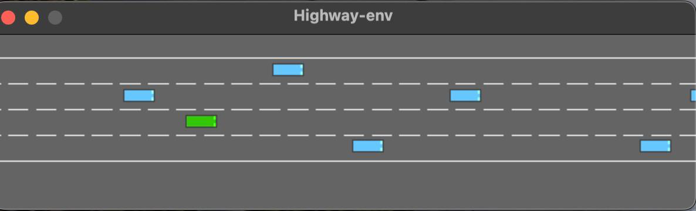
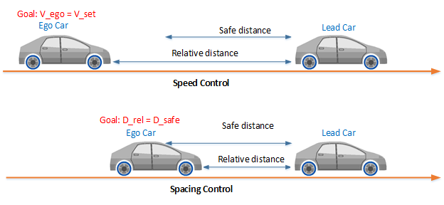
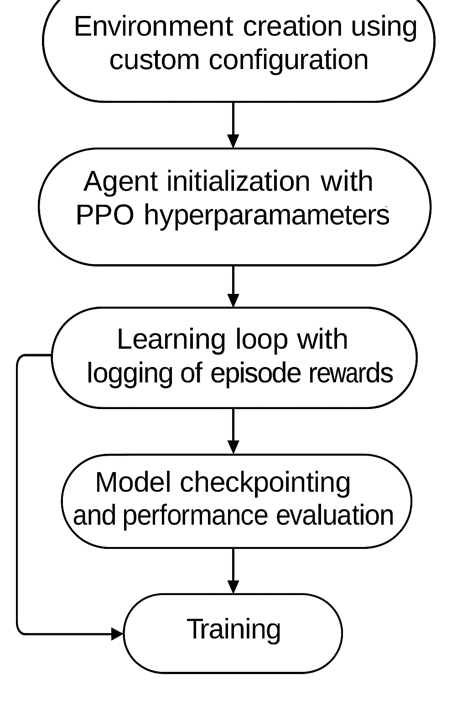
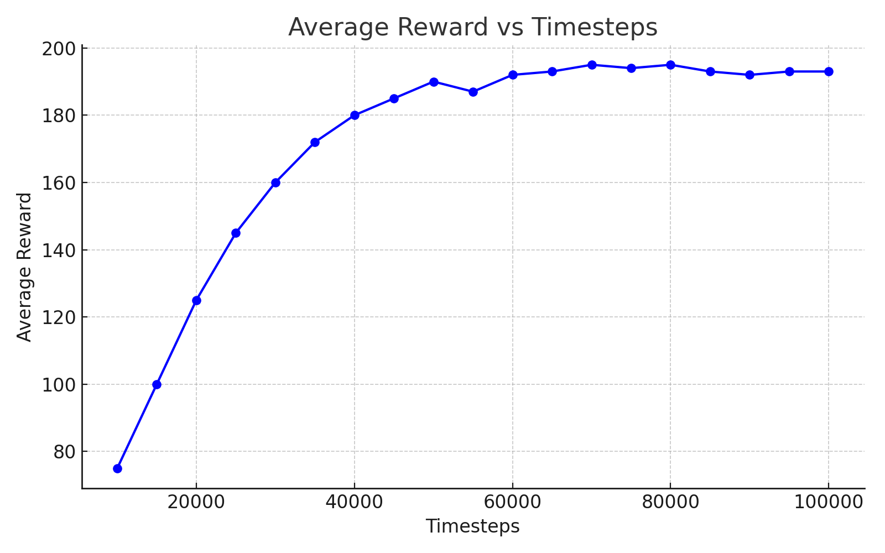
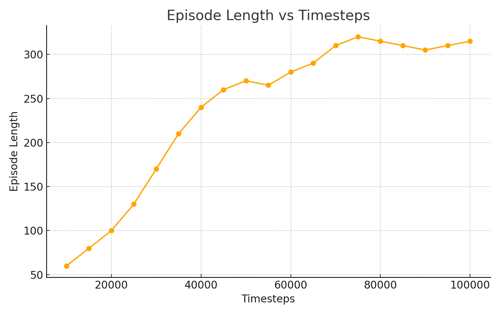
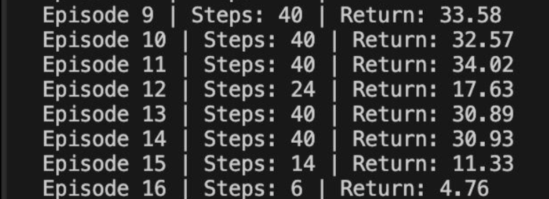

# 🚗 Adaptive Cruise Control with Deep Reinforcement Learning (PPO)

Train an intelligent **Adaptive Cruise Control (ACC)** agent in a simulated highway environment using **Proximal Policy Optimization (PPO)**. The agent learns to keep a safe distance from the vehicle ahead, maintain a target speed, and overtake slower traffic — all through trial and error, without any hand-written rules.



## ✨ Highlights

- 🤖 **PPO agent** trained with [Stable-Baselines3](https://github.com/DLR-RM/stable-baselines3) + a custom PyTorch implementation
- 🛣️ Realistic dense-traffic simulation: 4 lanes, up to 50 vehicles, **aggressive drivers**
- 🎯 Reward shaping for **safety** (−1 per collision), **speed** (target range 20–30 m/s) and **lane efficiency**
- 📈 Trained for **100,000 timesteps** — average reward rose from ~75 to ~195
- ⚖️ Benchmarked against **DQN, DDPG and SAC** baselines
- 🎮 Manual control mode to drive the car yourself

## 🧠 How It Works

ACC is a two-mode control problem:
- **Speed control** → keep the ego vehicle at a set speed when the road is clear
- **Spacing control** → keep a safe relative distance from the lead vehicle when following



We formulate the task as a **Markov Decision Process (MDP)** `(S, A, P, R, γ)`:

| Component | Description |
|---|---|
| **State space** | Ego vehicle speed & acceleration, distances to lead/trailing vehicles, lane index, adjacent-lane status |
| **Action space** | Discrete: maintain, accelerate, decelerate, change lane left/right |
| **Reward** | −1.0 collision · positive reward in 20–30 m/s speed range · small penalty for unnecessary lane changes · bonus for safe overtaking |
| **Discount γ** | 0.99 |

### Reward shaping

| Behavior | Reward |
|---|---|
| Collision | −1.0 |
| Speed within [20, 30] m/s | positive |
| Unnecessary lane change | small penalty |
| Safe overtake of slow traffic | bonus |

### Training pipeline



## 📊 Results

**Average reward during training (100,000 timesteps):** smooth, stable convergence with only minor fluctuations — a signature of PPO's clipped surrogate objective.



**Episode length over training:** episodes get longer, meaning the agent avoids early collisions and survives deeper into dense traffic.



**Final evaluation over 20 unseen episodes** — the agent consistently avoids collisions, keeps safe distances and overtakes strategically:



### Comparison with baselines

| Algorithm | Verdict |
|---|---|
| **PPO (ours)** | ✅ Best convergence and episode stability |
| SAC | Competitive rewards, but unstable lane selection |
| DDPG | Failed to generalize; highly sensitive to reward shaping |
| DQN | Underperformed due to its less flexible value-based updates |

## 🗂️ Project Structure

```
RL_Finaaaal/
├── main.py                  # Training entry point (Stable-Baselines3 PPO)
├── manual_control.py        # Drive the car manually
├── test_agent_PPO.py        # Evaluate a trained checkpoint
├── training/
│   ├── config.yaml          # Env + agent + training hyperparameters
│   ├── train.py             # Alternative training script (custom agent)
│   └── agent_PPO.py         # Custom PPO agent (actor–critic, PyTorch)
├── Models/
│   ├── acc_agent.py         # ACC agent wrapper
│   ├── base_agent.py        # Base agent class
│   ├── hyper.py             # Hyperparameters
│   ├── utils.py             # Env factory + reward shaping wrappers
│   └── PPO/                 # Trained actor/critic checkpoints
└── Figures/                 # Generated plots
```

## 🚀 Getting Started

### 1. Clone the repo

```bash
git clone https://github.com/<your-username>/<repo-name>.git
cd <repo-name>
```

### 2. Create a virtual environment & install dependencies

```bash
python -m venv venv
source venv/bin/activate          # Windows: venv\Scripts\activate

pip install gymnasium highway-env stable-baselines3[extra] torch matplotlib pyyaml
```

### 3. Train the agent

```bash
python main.py
```

Training config lives in `training/config.yaml` (4 lanes, aggressive vehicles, 60 s episodes, decision frequency 15). Checkpoints are saved every 25,000 timesteps.

### 4. Evaluate a trained checkpoint

```bash
python test_agent_PPO.py
```

### 5. Try manual control 🎮

```bash
python manual_control.py
```

## 🧪 Environment Configuration

```yaml
env:
  lanes_count: 4
  vehicles_count: 50           # dense traffic
  duration: 60
  policy_frequency: 15
  other_vehicles_type: "highway_env.vehicle.behavior.AggressiveVehicle"
```

## ⚙️ PPO Hyperparameters

| Parameter | Value |
|---|---|
| Learning rate | 2×10⁻⁴ – 3×10⁻⁴ |
| n_steps | 2048 |
| Batch size | 64 |
| n_epochs | 3–10 |
| γ (discount) | 0.99 |
| GAE λ | 0.95 |
| Clip range | 0.2 |
| Entropy coefficient | 0.01 |

## 🔮 Future Work

- Constraint-enforced RL (e.g. CPO) for **hard safety guarantees**
- Multi-agent training with interacting vehicles
- Perception noise & sensor-delay robustness
- Curriculum & imitation learning to cut training time
- Hybrid rule-based + learned policies for edge cases


## 📚 References

1. Y. Zhou & H. Liang — *SAINT-ACC: Safety-Aware Intelligent Adaptive Cruise Control* (arXiv)
2. X. Wang & L. Chen — *Safe Deep Reinforcement Learning for Adaptive Cruise Control*, Sensors 2024
3. H. Hailemichael et al. — *Safety Filtering for RL-based ACC* (arXiv:2301.00884)
4. [highway-env](https://github.com/Farama-Foundation/HighwayEnv) — Autonomous driving simulation environment
5. [Stable-Baselines3](https://github.com/DLR-RM/stable-baselines3) — Reliable RL implementations
